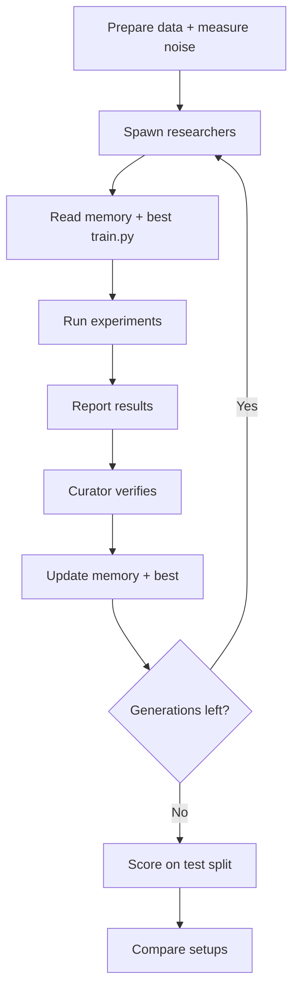

# Shared Brain

A shared memory layer for a team of ML research agents, built on Crusoe Managed Inference.

Every new agent on a team usually starts from zero and pays again for the same context. In Shared Brain, short-lived researcher agents read a shared memory before they work, and a curator keeps that memory **current, lean and conflict-free**. Each generation starts fresh but smarter, and we measure the gain as validation loss.

## How it works



1. Before generation 1, the orchestrator runs the starting `train.py` on 5 seeds to get the baseline loss and the noise level.
2. Each generation, 4 researchers start from the best `train.py` so far plus memory.
3. Each researcher runs experiments to lower val loss, then reports what it learned.
4. The curator re-checks the top claim, settles conflicts and updates memory.
5. At the end, the starting and best `train.py` are scored on the hidden test split.

## Setups

Both setups use the same dataset, splits, models, sandbox and total number of runs. Every generation starts from the best `train.py` so far, so **memory is the only difference**.

| Setup | What it shows | What researchers read | Who picks the best `train.py` |
|---|---|---|---|
| No memory | Every agent starts from zero | Nothing | Orchestrator: lowest val loss |
| **Shared Brain** | Curated memory: lean and current | Curated memory, 2,000-token cap | Curator check on 3 seeds |

A new best must beat the old one by more than the noise threshold, in both setups.

## Budget

| Item | Value |
|---|---|
| Generations | 5 |
| Researchers per generation | 4 |
| `run_code` calls per researcher | 6 (Shared Brain), 7 (No memory) |
| Curator runs per generation | 4: 3 seeds to verify the top claim, 1 for a conflict or stale entry |
| Total runs per generation | 28 in both setups |
| Agent turns per researcher | 30 max |
| One run | 120 s, 2 CPUs, 4 GB RAM, no GPU, no network |
| Seeds | Researcher runs: 0. Curator checks: 1, 2, 3. Test scoring: 1, 2, 3 |

Crashes and timeouts use up a run.

## Data

We use one dataset, churn, split three ways.

| Split | Who sees it | Use |
|---|---|---|
| Train | Researchers, curator | Training |
| Val | Researchers, curator (inputs only, never labels) | Scoring during research |
| Test | No agent | Final before-and-after comparison only, run by `test.py` |

- Researchers never see the test split: not its data, its loss, or any score built from it.
- The curator doesn't see it either. It verifies claims on val, because what it learns goes into memory, and researchers read memory.
- Agent code never sees val labels. `train.py` returns predictions and the orchestrator scores them outside the sandbox.

| Step | The sandbox gets | The sandbox never gets |
|---|---|---|
| Research (`run_code`) | Train, val inputs | Val labels, any test data |
| Final scoring (`test.py`) | Train + val (with labels), test inputs | Test labels |

### Data source

| Predicts | Dataset | Val loss | Split |
|---|---|---|---|
| Will this customer leave? (yes/no) | [OpenML 46371](https://www.openml.org/d/46371) (35k customers, free, no login) | Log loss | Random 70/15/15, stratified, seed 42 |

Why churn: clear room to improve (~20%) and stable between runs.

`scripts/prepare_data.py churn` downloads the dataset, splits it and saves it to `data/churn/` (git-ignored): `train.parquet`, `val_X.parquet`, `val_y.parquet`, `test_X.parquet`, `test_y.parquet` and `meta.json` (target column, loss, split rule).

## Files

| File | Access |
|---|---|
| `train.py` | The only file agents can edit |
| `sandbox/harness.py` | Locked. Runs `train.py` on train, predicts val inputs, returns predictions |
| `sandbox/test.py` | Locked; agents can't see, edit or run it. Only the orchestrator runs it |

### The `train.py` contract

```python
import numpy as np
import pandas as pd


def fit(train: pd.DataFrame, target: str, seed: int) -> object: ...
def predict(model: object, X: pd.DataFrame) -> np.ndarray: ...
```

- `predict` returns the chance of leaving (0 to 1) for each row.
- `test.py` fits on train + val, then predicts the test inputs, for seeds 1, 2 and 3.
- Allowed libraries: numpy, pandas, pyarrow, scikit-learn, lightgbm, xgboost, catboost, torch (CPU). No installs at runtime.

The starting `train.py` is logistic regression, in `baselines/churn/train.py`.

## Tools

| Tool | Input | Returns |
|---|---|---|
| `get_memory` | — | Memory as text |
| `run_code` (researcher) | `code` (the whole `train.py`), `note` (one line: what changed) | `run_id`, `status` (ok / error / timeout), `val_loss`, last 2,000 characters of output, `runs_left` |
| `run_code` (curator) | `run_id` to re-check, or `code` | Mean and spread of val loss over seeds 1, 2, 3, and `beats_best` (true if it beats the best by more than the noise threshold). Uses 3 runs |
| `upsert_memory` | `kind` (works / failed / try_next), `claim` (200 characters max), `run_ids`, optional `id` to edit | `id`, tokens used, token cap. Refused if over the cap |
| `remove_memory` | `id` | ok |

The memory tools are our own, backed by `memory.jsonl` (see [Storage](#storage)). Crusoe has no memory API.

## Agents

| Agent | Model | Tools |
|---|---|---|
| **Researcher** (×4) | `nvidia/Nemotron-3-Super-120B-A12B` | `get_memory`, `run_code` |
| **Curator** (×1) | `deepseek-ai/DeepSeek-V4-Pro` | `get_memory`, `run_code` (to re-check), `upsert_memory`, `remove_memory` |

- Researcher focus areas: features, model type, tuning, regularization and ensembling.
- Researcher settings: temperature 1.0, top_p 0.95, `chat_template_kwargs: {"enable_thinking": true, "force_nonempty_content": true}`, max_tokens 8192.
- Curator settings: `chat_template_kwargs: {"thinking": true}`, max_tokens 8192.
- At start, the orchestrator checks all model IDs against `/v1/models` and stops if one is missing. Nemotron 3 Ultra isn't on Crusoe's serverless list today; if it appears, it can replace the curator model.
- The orchestrator is a plain Python script, not an agent.

### Prompt order

Researchers in a generation share the same start of the prompt, so Crusoe's cache reuses it:

1. Rules and tool list (same for everyone)
2. Dataset card (`meta.json`)
3. Memory
4. Best `train.py` so far
5. This researcher's focus
6. The conversation

### Report

A researcher's final message is its report:

```
Tried: one line per idea
Best run: <run_id>
Learned: what worked or didn't, and why
Next: ideas not yet tried
```

The orchestrator attaches the researcher's run log (note, status and val loss per run) before passing it to the curator. **Ranking uses the run log, not the report.**

## Rules

- **Memory writes:** only the curator writes to memory.
- **Memories come from runs:** only results from `run_code` become memories.
- **Budget:** enforced inside `run_code` (time and run limits), so no one wins by training longer.
- **Test split:** no agent can read it or get a score on it, so nothing tuned on it leaks into memory or `train.py`.

## Generation loop

1. **Once per research run:** run the starting `train.py` on seeds 0 to 4. `L0` is the mean. The noise threshold is the larger of 2 × the spread and 0.5% of `L0`.
2. **Each generation:**
   1. Run 4 researchers in parallel from the best `train.py` and the current memory.
   2. Rank them by gain over the generation's starting best, from the run log.
   3. Update memory: the curator (Shared Brain), or nothing (No memory).
   4. Update the best `train.py` if a run beats it by more than the noise threshold.
   5. Append this generation's metrics to `generations.jsonl`.
3. **At the end:** `test.py` scores the starting and the best `train.py`.

## Curation

Each generation, the 4 researchers are ranked by **gain over the generation's starting best** (not raw val loss). The curator reads every report; rank decides what it does with each one.

| Rank | Curator action |
|---|---|
| **Top 1** | Re-run with `run_code` on 3 seeds. If `beats_best`, add it to memory as a fact; the orchestrator updates the best `train.py` |
| **Middle 2** | Keep only new ideas, as `try_next` |
| **Bottom 1** | Record briefly as `failed` so it isn't retried |

- **Losers are kept on purpose:** failed runs are the "what failed" part of memory.
- **Noise:** gaps smaller than the noise threshold count as ties. Only claims that clear it become facts.
- **Conflicts:** if the top claim contradicts an entry, or an entry is stale, the curator's 4th run settles it.
- **Budget:** re-running is the curator's expensive step, so ranking decides where it's spent.

## Memory

The store holds four kinds of entry:

- **works:** findings, with proof.
- **failed:** dead ends not to retry.
- **try_next:** open questions.
- **best:** the top config and score (set by the orchestrator only).

Each entry has: `id`, `kind`, `claim`, `run_ids`, val change, seeds, `tested_on` (best version), created and updated generation.

Rules for the memory:

- **Lean:** 2,000-token cap (counted as characters ÷ 4). If still over the cap after curation, drop the oldest `try_next`, then the oldest `failed`. Never drop `best`.
- **Current:** an entry tested on a best that is 2 or more versions old is stale. The curator re-tests or removes it.
- **Conflict-free:** only the curator writes to it, and contradictions are settled by an experiment.
- **Stable text:** memory is rendered in a fixed order (best, works, failed, try_next, then by `id`) so the cache can reuse it.

### Why Crusoe MemoryAlloy

Every researcher's prompt starts with the same memory (see [Prompt order](#prompt-order)), so Crusoe's [MemoryAlloy](https://crusoe.ai/resources/blog/crusoe-memoryalloy-reinventing-kv-caching-for-cluster-scale-inference) reads it once and reuses that work for the other researchers. Sharing memory stays cheap and fast: each researcher pays less and starts answering sooner.

## Scoring

```
gain    = (L0 − Lbest) / L0
fitness = average gain across seeds 1, 2, 3
```

- **`L0`:** loss of the starting `train.py`.
- **`Lbest`:** loss of the best `train.py` reached within the budget.
- During research, both are val loss. For the final score, `test.py` measures both on the test split, with the best `train.py` picked by val loss.

## Evaluation

Both setups use the same dataset and budget, and are scored on the same test split. We track three metrics per generation:

- **Quality:** val gain of that generation's best `train.py`. Test gain is measured once, at the end (fitness).
- **Memory size:** tokens of what researchers read. Curated memory should stay under the cap.
- **Tokens:** prompt, cached and output tokens per agent, from each response's `usage`. Cached tokens show the [MemoryAlloy](#why-crusoe-memoryalloy) reuse.

At the end, the orchestrator prints a results table from the files in `data/`: one row per research run with setup, fitness, best val loss per generation, memory tokens and tokens used.

Expected size: about 150 sandbox runs and under 2 hours per research run, so about 300 runs for both setups. Run them in parallel.

## Storage

No database. Everything is a file under `data/` (git-ignored), read and written with `app/store.py`. JSONL files are append-only, except `memory.jsonl`.

```
data/
  churn/                       dataset splits from prepare_data.py; copied into each sandbox
  research_runs.jsonl          one line per finished research run: dataset, setup, config, L0, noise threshold, fitness
  research_runs/<run_id>/
    generations.jsonl          one line per generation: index, start and end best val loss, best version, memory tokens
    experiments.jsonl          one line per sandbox run: agent, seed, status, val loss, runtime, note, output tail, train.py code
    agents.jsonl               one line per agent session: role, focus, model, report, transcript, tokens
    memory.jsonl               current memory, one entry per line; rewritten on every change
```

## Code layout

```
app/
  orchestrator.py        # CLI: uv run python -m app.orchestrator --dataset churn --setup shared_brain
  loop.py                # generation loop, ranking, best tracking
  agents/                # researcher.py, curator.py, prompts.py, tools.py
  memory.py              # entries, rendering, cap, staleness
  scoring.py             # losses, noise threshold, gain, fitness
  store.py               # JSONL helpers: append, read, rewrite
  services/              # inference.py, sandbox.py
  api/routes/            # health.py, playground.py (setup checks only)
sandbox/                 # harness.py, test.py (locked, copied into the sandbox)
baselines/churn/train.py
scripts/prepare_data.py
```

## Settings

New settings go in `app/config.py` and `.env.example`:

| Setting | Default |
|---|---|
| `RESEARCHER_MODEL` | `nvidia/Nemotron-3-Super-120B-A12B` |
| `CURATOR_MODEL` | `deepseek-ai/DeepSeek-V4-Pro` |
| `SANDBOX_TIMEOUT_SECONDS` (exists) | `120` |
| `SANDBOX_CPU` | `2` |
| `SANDBOX_MEMORY_MB` | `4096` |

Budget numbers live in a `ResearchConfig` model with the defaults above, and can be overridden from the CLI.

## Build order

1. Churn data prep, baseline, `harness.py`, `run_code`: the baseline gets a val score.
2. One researcher, one generation.
3. 4 researchers, ranking, best tracking: the No memory setup works.
4. Curator and memory: the Shared Brain setup works.
5. `test.py` and the final results table.

## Done when

- `uv run python -m app.orchestrator --dataset churn --setup shared_brain` finishes 5 generations and saves fitness.
- Both setups run on churn and the results table shows their fitness.
- Tests (no network) cover: val and test labels never reach the research sandbox, run limits, memory cap and dropping order, staleness, ranking with ties, equal total runs across setups, scoring math.
- `uv run ruff check . && uv run ruff format . && uv run pytest` passes.

## Out of scope

GPUs, fine-tuning, other datasets (superconductivity, Walmart M5), more setups (One-shot, Raw log), web search for researchers, a dashboard, the waste metric, cost in dollars and time-to-first-token, memory history, agents editing anything but `train.py`, repeating whole research runs (add only if time allows).

## Models (Crusoe Managed Inference)

| Role | Model |
|---|---|
| Researcher | `nvidia/Nemotron-3-Super-120B-A12B` |
| Curator | `deepseek-ai/DeepSeek-V4-Pro` |

Add a payment method to the Crusoe project: it raises the limit from 30 to 600 requests per minute per model.

## Tech stack

| Layer | Tool |
| --- | --- |
| Setup checks | [FastAPI](https://fastapi.tiangolo.com) (Python 3.12+, uv) |
| Storage | JSONL files in `data/` (no database) |
| LLM inference | [Crusoe Intelligence Foundry](https://console.crusoecloud.com/foundry) (OpenAI-compatible API) |
| Code sandboxes | [Modal Sandboxes](https://modal.com/docs/guide/sandboxes) |

## Setup

You need [uv](https://docs.astral.sh/uv/), a Crusoe API key and a Modal account.

```bash
uv sync
cp .env.example .env          # then paste CRUSOE_API_KEY into .env
uv run modal token new        # opens a browser, saves ~/.modal.toml
uv run fastapi dev app/main.py
```

Get the Crusoe key from Console → Intelligence Foundry → API Keys. Keys can contain `$`, so don't wrap them in double quotes.

To check that everything works, open http://localhost:8000/docs:

- `GET /playground/models` lists models: the Crusoe key works.
- `POST /playground/sandbox` with `{"code": "print('ok')"}` prints `ok`: Modal works. The first run builds the image (1–2 min).

Built at the Crusoe x Cerebral Valley Recursive Agents Hackathon, SF, Oct 2026.
